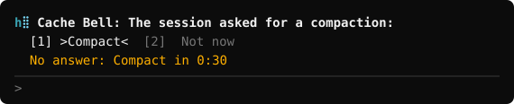
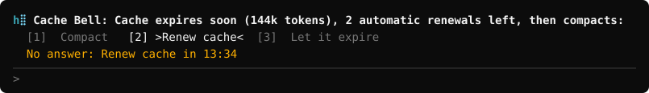
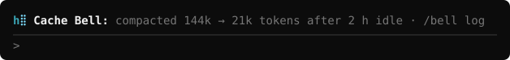
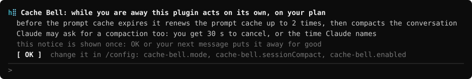

<h1>
  <picture>
    <source media="(prefers-color-scheme: dark)" srcset="docs/hb-mark-dark.svg">
    
  </picture>
  Cache Bell
</h1>

   

**A cache & context manager for Claude Code.** Once the context passes a size you choose, Claude compacts
after a finished piece of work, and you get time to cancel. While you're away, the plugin keeps the prompt
cache warm or compacts before it expires.

Claude Code compacts an idle session on its own only above roughly 200k tokens, and you can run `/compact`
any time. With Cache Bell, Claude compacts at a size you choose, after a finished piece of work, and the
cache can be kept warm while you're away.

### Context

**1. Claude compacts the conversation itself**, once the context passes 200K (`compactLevelK`) and a piece
of work is done. By default you get 30 seconds to cancel; `compactOnRequest` sets whether it compacts
after that countdown, waits for your answer, or compacts at once. `/bell set 300K` gives one session a level of its own.



**2. It can leave itself a note** about what comes next. Once the compaction is done, the plugin sends
that note back, so the session can carry on without you.

**3. Your own instructions for the summary**, with the time and how long the session was idle. A
compaction waits while you are typing or a subagent is running, and `/bell log` shows the size before and
after and who decided.

**4. Tells Claude how full the context is.** From half the window on, Claude gets a short line with the
context's size; you don't see it, and no request is sent for it.

### Cache

**5. Keeps the cache warm while you are away:** it renews it twice by default, three times at most.



**6. Compacts an idle session while the cache is still warm**, not after it has expired: by default only
while the cache lives an hour. Right before, it tells the session that a compaction is coming, so it can
save its work in progress.


**7. Shows in the status line whether the cache is still warm or already cold.** The countdown appears
once 15 minutes or fewer are left. Questions show in the band, a line above the prompt, in the terminal
only.


**8. Asks for the hour-long cache if you want it.** The first-run notice asks what you usually do after
Claude replies. Only if you answer that you come back within the hour does the plugin ask Claude Code for the hour-long
cache, see [The hour-long cache](#the-hour-long-cache).

While you are away it asks first; with no answer it acts on its own, and those requests count against
your plan. With `cache-bell.profile` = `watch` nothing is sent and Claude is told nothing. A context under
80 000 tokens is left alone when the cache runs out (`idleMinContextK`).

### Before you rely on it

- The band and its questions show in the terminal only. In a session you follow over Remote Control (the
  desktop app, a phone) nobody sees them, so when the countdown ends the plugin goes on as if you had not
  answered. With the default settings that ends in a compaction, both when Claude asks for one and before
  an hour-long cache expires, and a compaction cannot be undone. If you follow sessions over Remote
  Control, set `cache-bell.compactOnRequest` to `wait` and `cache-bell.idleCompact` to `off`: then nothing
  is compacted without your answer. With `cache-bell.profile` = `watch` nothing is sent at all.
- 0.3.4 is experimental. The desktop app's Code tab and the SDK are not supported yet; in `claude -p` the
  plugin does nothing, except that it removes the hour-long cache setting it inherited from the plugin.
- Coming from 0.2.x: the options have new names, and Claude now compacts by itself past 200K. See
  [CHANGELOG.md](CHANGELOG.md) for what was taken over and how to keep the behaviour of 0.2.13.

[Quick start](#quick-start) · [How it works](#how-it-works) · [What it sends](#what-it-does-on-its-own-and-what-it-sends) · [Privacy](#privacy)

## Quick start

In your shell:

```
claude plugin marketplace add hollerbell/cache-bell
claude plugin install cache-bell@cache-bell
```

Then open a new session, or run `/reload-plugins` in one that is open:

- `/bell demo 30` shows the question for 30 seconds and sends nothing;
- `/bell status` says the plugin's version, what it sees and, in one sentence, what it will do.

In a conversation below 80 000 tokens the plugin only shows the countdown when the cache runs out: it does
not ask, renew or compact on its own. A compaction Claude asks for is not affected.

To update later, since Claude Code does not update this plugin on its own:

```
claude plugin marketplace update cache-bell
claude plugin update cache-bell@cache-bell
```

Then run `/reload-plugins` in every session that is open. Installed from a clone, or to have it updated
automatically: see [Update](#update).

To try it for one session without installing, clone the repository and run in the clone:
`claude --plugin-dir .`

0.3.4, experimental. Needs Claude Code 2.1.288 or newer, and was tested with each release up to 2.1.294 (the plugin
uses the mods API, which is early access and changes between releases). Tested on Windows and macOS, in
the terminal; Linux is not tested yet. Before you rely on it, read [the points above](#before-you-rely-on-it).

**Feedback is welcome.** Tell us what works, what breaks and what is missing: [open an issue](https://github.com/hollerbell/cache-bell/issues).

## Three ways to use it

1. **Leave a long session over lunch.** Do nothing: before the cache runs out the plugin asks in the band,
   renews the cache twice and then, on an hour-long cache, compacts, so your first message after the break
   does not send the whole context again. On a five-minute cache it lets the cache expire after the
   renewals: your first message after the break then sends the whole context again as a new cache write,
   at the full input price plus the surcharge for writing.
2. **Decide yourself.** When the question appears, type `2` and Enter to keep the cache warm, `1` to compact
   now, `3` to let it expire. `/bell demo 30` shows the question without sending anything.
3. **Let Claude pick the moment.** Past 200K Claude compacts after a finished piece of work by itself. Below
   that, say "compact when you are done with this task". Claude finishes, asks the plugin for a compaction,
   and by default you get 30 seconds to cancel.

## Commands

| Command | What it does |
| :- | :- |
| `/bell` or `/bell status` | The plugin's version, the profile (for example `bellcompact[200K]`), one sentence on what it will do, and what it sees: the state, the TTL and where it comes from, whether the hour-long cache was asked for and granted, the time of the last request, what comes next and when. While Claude is working it is shown at once, as a notice of one line. |
| `/bell set 300K\|off\|default` | Gives the current session a compaction level of its own, from 1K to 10000K. `off` turns off compaction by size for this session, `default` goes back to `compactLevelK`. Nothing is written to your settings. |
| `/bell hour [on\|off]` | Changes your answer about the hour-long cache, for every session on this machine. Without an argument, it shows your current answer. |
| `/bell report` | What a report of a problem needs, to paste into an issue: the versions, the model, whether another provider or an API address of your own is set, the options, the state, the counts of the events the plugin has seen, the size of the transcript and the usage figures of its last response, and the plugin's last notices, of each only the plugin's own words. No message text, no file path, no address, no key. Typed while Claude is working, it is printed when the turn is over. |
| `/bell log [count]` | The last compactions, ten when no count is given, 200 at most. |
| `/bell demo [seconds] [bg] [stay]` | Shows the question for that many seconds (1 to 600, 30 when none is given) and sends nothing. `bg` swings the background instead of the text; `stay` keeps the question up when you send a message. |
| `/bell show calm\|act\|cold\|intro` | Holds the band in one of its looks, or puts the first-run notice up, for a screenshot. `/bell show off` puts the real band back. |

Started with the environment variable `CACHE_BELL_DEMO=30`, a session shows the demo question by itself,
for 30 seconds; `CACHE_BELL_DEMO="30 bg"` swings the background.

None of these sends anything to the model.

## Options

Set them in `/config` (rows named `cache-bell.*`) or in `settings.json` under
`pluginConfigs["cache-bell@cache-bell"].options` (loaded with `--plugin-dir`, the key is
`cache-bell@inline`). `/config` shows every option with its value, defaults included. In the form under `/plugin`,
a number or text option you have not set stays empty; its default still applies, and the option's
description names it.

| Option | Default | What it sets |
| :- | :- | :- |
| `enabled` | `true` | Off pauses the plugin without uninstalling it: it shows and sends nothing, whatever the profile. |
| `profile` | `bellcompact` | `off`: nothing. `watch`: the countdown and the context's size only; nothing is sent and Claude is told nothing. `bellcompact`: everything the options below set. With `watch`, the hour-long cache, if you asked for it, stays on; `/bell hour off` turns it off. |
| `compactLevelK` | `200` | From this size of the context on, in thousands of tokens, Claude is asked, in a line you do not see, to compact at the next good point. `0` = never; the cache is still renewed. `/bell set` changes it for one session. |
| `compactContextNotices` | `true` | From 50 % of the window on, Claude gets a one-line notice of the context's size after a tool result: again every further 5 %, and at 85, 90 and 95 %. You don't see it; no request is sent for it. |
| `compactOnRequest` | `confirm` | What Claude's own request for a compaction does: `confirm` asks you and compacts when the countdown ends, `wait` asks you and compacts only if you say so, `auto` compacts right after the turn, `off` refuses. |
| `compactCountdown` | `30` | Seconds you have to cancel a compaction Claude asked for, 5 to 3600. Claude may name a time of its own with a request, 10 to 600 seconds. |
| `compactInstructions` | empty | Instructions for the summary when the plugin compacts. Empty: a plain summary. See below the table. |
| `idleMinContextK` | `80` | Below this, in thousands of tokens, nothing is done about the cache of an idle session. A compaction Claude asks for is not affected. |
| `idleAsk` | `first` | When you are asked before the plugin renews or compacts an idle session's cache: `first` (the first time in an idle period, and again before a compaction), `every` or `never`. |
| `idleAskAheadMinutes` | `0` (automatic) | How long before the time to act the question appears: automatically 15 minutes on an hour-long cache, 30 seconds on a five-minute one. |
| `idleRenewals` | `2` | How many times an idle session's cache is renewed, 0 to 3. A renewal that gets no response is tried once more, within the limit of three. |
| `idleRenewPrompt` | `This request only keeps the prompt cache warm. Answer with the single word: ok` | The prompt of a renewal. |
| `idleCompact` | `auto` | Whether an idle session is compacted once the renewals are used up, before the cache expires. `auto`: only while the cache lives an hour; a five-minute cache is left to expire. `on`: always. `off`: never. |
| `idleAnnounce` | `true` | Tell the session that a compaction is coming, in a turn of its own, right before it. |
| `idleAnnouncePrompt` | `This conversation will be compacted right after this turn. Nothing is needed from you: a one-line reply is enough.` | What the session is told before a compaction. Empty = nothing. |
| `cacheTtl` | `auto` | `auto`: the lifetime the API granted, read from the transcript. `settings`: the transcript is never read; the lifetime is then only a guess, so the plugin does nothing on its own while the session is idle. `5m` or `1h`: set by hand. The plugin then does not read the transcript for the TTL, and Claude Code still asks the API for its own default; for the hour-long cache, see `cacheRequestHour`. With `5m` the plugin does not ask for the hour-long cache, so the TTL it counts with is the one the cache really has. |
| `cacheRequestHour` | `ask` | `ask`: the first-run notice asks what you do after a reply, and only "come back within the hour" (or `/bell hour on`) asks for the hour-long cache. `on`: always. `off`: never. See [The hour-long cache](#the-hour-long-cache). |
| `display` | `status` | Where the countdown shows: `band` (above the prompt), `status` (the status line), `both` or `off`. Questions always show above the prompt. |
| `displayBelowMinutes` | `15` | The countdown shows once this many minutes or fewer are left; `0` = always. |

`compactInstructions` works like the text after `/compact`, but only for the compactions the plugin starts:
before an idle session's cache expires, and when Claude asks for one. Your own `/compact` and Claude Code's
automatic compaction do not use it. Two placeholders are filled in: `{time}` with the time of the
compaction in UTC, such as `2026-10-11 21:40 UTC`, and `{idle}` with the minutes since your last
message, or `?` when that is not known. For example:
`Compacted at {time} after {idle} minutes idle. Keep the open tasks, the decisions and the file paths.`

`mode` from 0.2.x still counts as long as `profile` and the other options it sets stay at their defaults;
`mode` set to `custom` has no effect. `/config` lists it marked (0.2.x). The other options of 0.2.x, `ttl`
among them, are no longer read; [CHANGELOG.md](CHANGELOG.md) lists their new names.

## How it works

Claude Code keeps your conversation cached at the API for 5 minutes or 1 hour. Come back later than
that and your next message sends the whole context again, uncached.

Cache Bell counts that time down in the status line and acts before it runs out. What it does then, and
what that sends, is under [What it does on its own](#what-it-does-on-its-own-and-what-it-sends).

Claude Code compacts an idle session on its own only above roughly 200k tokens. With Cache Bell, Claude
compacts at a size you choose, after a finished piece of work, by default with a countdown to cancel, and
an idle session's cache can be kept warm instead.

Measured once (Claude Code 2.1.288, Windows, Haiku, a subscription plan, the minimum context set to
40 000 tokens): an hour-long cache was renewed at minute 50. A message at minute 63 read the whole context,
42 571 tokens, from the cache and wrote 374.

The pictures are drawings, not screenshots: they use the plugin's own texts and colours on a dark terminal.
A light theme gets darker colours.

## Answering the question

- The first line says why it asks, how large the context is that would be sent again, and how many
  renewals the plugin would still do on its own.
- The choice between the arrows is the one that is done when the countdown on the last line ends.
- Type a choice's digit into the empty prompt to select it; Enter does it at once. The digit is not sent
  to the model.
- A click on a choice does it at once.
- Any other message you send closes the question: your turn renews the cache anyway.
- A message from another session, or a background task's result, only interrupts the question: when that
  turn ends, a compaction Claude asked for is offered again, with the time the countdown had left and at
  least ten seconds. A digit you had typed still selects its choice.
- While a question is open, a message that is exactly one of its digits answers the question, even if
  Claude has just asked you to pick "1 or 2". Write more than the digit to answer Claude.

## What it does on its own, and what it sends

After installation the plugin runs the profile `bellcompact`. While you are away it asks, and when
nobody answers it renews the cache twice. On an hour-long cache it then asks once more, tells the session
and compacts the conversation, about two and a half idle hours after your last request. The second
question has `Compact` selected, so whoever is at the machine can still say no. On a five-minute cache it
lets the cache expire after the renewals, about 13 minutes after your last request: people often come back within the
hour, and a compaction would then cost more than it saves. `idleCompact` = `on` compacts on a five-minute
cache too, `off` never.

A renewal is one request that reads the whole context from the cache, the announcement is one short
turn, a compaction is one summary. A compaction replaces the conversation with that summary: what the
summary leaves out is gone from the context. These requests count against the limits of your plan, or
are billed to your API key. The plugin never sends more than three renewal requests in one idle period,
answered or not; only your own message starts the count over.

A conversation below 80 000 tokens is left alone when the cache runs out: the plugin only shows the
countdown (`idleMinContextK`). A compaction Claude asks for still comes.

| Profile | What it does | Requests the cache timer sends without your answer |
| :- | :- | :- |
| `off` | Nothing. | none |
| `watch` | The countdown and the context's size. Claude is told nothing. The hour-long cache, if you asked for it, stays on; `/bell hour off` turns it off. | none |
| `bellcompact` (default) | Asks, renews twice; on an hour-long cache asks again, announces, compacts. Past `compactLevelK` Claude compacts after a finished piece of work. | at most five per idle period on an hour-long cache: two renewals, one retry if a renewal got no answer, the announcement, the compaction; at most three on a five-minute cache |

Claude itself asks for a compaction once its work is done and the context is past `compactLevelK` (200K by
default): after a tool result it gets a line, which you do not see, saying that you want a compaction at
the next good point. Below that it may ask too, for example when you tell it to. The skill `compact` tells it when, and
it asks through the plugin's tool `compact`. You get 30 seconds to cancel, or the time Claude asked for
(10 to 600 seconds; less when the cache runs out sooner); without an answer the conversation is compacted.
When you ask Claude for the compaction yourself, in your own message, the countdown is three seconds.
When to ask is yours to say, for example "compact after every finished task" or "only suggest it". With
`cache-bell.compactOnRequest` = `wait` nothing is compacted unless you say `Compact`; with `auto` it
compacts without the countdown.

A compaction leaves the session idle until somebody writes. So when Claude asks for a compaction, it may
leave itself a note about what comes next. Once the compaction is done, the plugin sends that note back as
a prompt, and the question, when there is one, says that the session `will continue after it`. The note is
marked as Claude's own, not as your message. The note is not sent when you cancel, when you send a message
during the countdown, when the prompt box holds a message you are writing, when other work has started
since the compaction began, or when the compaction fails. After three compactions in a row that were
followed by a note, no further note is sent until you write a message. A compaction started by the cache
timer never sends a note.

A compaction the timer starts waits while you type (a key in the prompt box within the last minute) and
while a subagent of the session still runs. It never waits past the cache: if the cache runs out first,
nothing is compacted and the band says so. Text that only lies in the prompt box holds nothing back, and
neither does a background shell command. Your own answer `Compact` is carried out at once.

After a compaction of its own the band says what was done, until your next message:



To change what it does, in `/config`:

- `cache-bell.profile` = `watch`: the countdown and the context's size only; nothing is sent and Claude
  is told nothing. The hour-long cache, if you asked for it, stays on; `/bell hour off` turns it off;
- `cache-bell.compactLevelK` = `0`: Claude is not asked to compact at any size; `/bell set off` does the
  same for one session;
- `cache-bell.compactOnRequest` = `wait`: a compaction Claude asks for waits for your answer;
- `cache-bell.compactOnRequest` = `off`: Claude's own request is refused;
- `cache-bell.idleCompact` = `off`: an idle session is never compacted, the cache expires;
- `cache-bell.enabled` = off: the plugin shows and sends nothing until you turn it on again.

To keep what 0.2.13 did by default, set `compactLevelK` to 0, `idleCompact` to `on`, `idleMinContextK` to 100,
`display` to `band` and `displayBelowMinutes` to 30.

The first time the plugin runs on a machine, the band says the same and stays up until you press OK or
send a message. It also asks what you usually do after Claude replies, see
[The hour-long cache](#the-hour-long-cache). A machine that ran 0.2.x is told once that Claude now
compacts by itself past the level.



## How the time is counted

The cache lifetime runs from the moment the **last request was sent to the API**, not from the end of
the turn. A turn that runs tools for two minutes after its last request has two minutes less.

| | 5-minute cache | 1-hour cache |
| :- | :- | :- |
| the question appears | 3:30 | 35:00 |
| time to act | 4:00 | 50:00 |
| too late | 4:35 | 55:00 |

The countdown runs to "too late", the last moment a request is still sure to hit the cache.
After a compaction the plugin sleeps until you work in the session again.

The TTL is known from two sources only: the `cacheTtl` option set to `5m` or `1h`, and the transcript, where each
response shows what the API really granted. The Claude Code settings (`FORCE_PROMPT_CACHING_5M`,
`CLAUDE_CODE_PROMPT_CACHE_TTL`, `promptCacheTtl`) and a model switch say only what was asked for, and the
API may grant less: since Claude Code 2.1.293 an interactive session gets five minutes unless the hour is
asked for. Until a response shows the TTL, the band says that it is not known yet, the status line shows
`cache lifetime unknown`, and the plugin does not ask, renew or compact on its own. In a new session that
is usually only until the first response. A compaction Claude asks for still comes. One that waits for
your typing or a subagent meanwhile waits up to an hour, the longest the cache may live, and the band says
`lifetime 1h assumed`; if the cache lives only five minutes, it may be cold by then.

The transcript is read when a turn ends, and once its TTL is confirmed no more than every two minutes;
a transcript that did not grow is not read at all. If it cannot be read, the band says so, the plugin
tries again (after 15 seconds, after a minute, then every five minutes), and until a read goes through it
does not ask, renew or compact. With `cacheTtl` = `settings` the transcript is never read: the lifetime
is then only a guess from what the settings ask for, so the plugin does nothing on its own while the
session is idle. To have it act, set `cacheTtl` to `5m` or `1h`.

Where the transcript is, the plugin learns from Claude Code, at the end of a turn and when a session
starts. Where those events do not reach it, it looks for the file by the session's id in Claude Code's
folder, and uses it only when it is there.

A session you resume (`claude --resume`, `--continue`, a fork) starts in a new process that has sent no
request yet. The plugin then reads the TTL and the time of the last request from the transcript right
away, so the band and `/bell status` show from the start how long the cache still lives, or that it ran
out while the session was closed. From there the session is watched like any other: with time left, the
plugin asks, renews and compacts as the options say. Where the transcript is not read or cannot be, the
time comes from Claude Code, which says how long ago the last response came. Without `cacheTtl` set to `5m` or `1h` the
TTL is then not known, and the plugin does not ask, renew or compact on its own until it is. A session
that was compacted after its last response is left alone until you work in it, as after any compaction.

## The hour-long cache

Since Claude Code 2.1.293 an interactive session gets a five-minute cache unless the hour is asked for.
The first-run notice asks what you usually do after Claude replies: reply within a few minutes, step away
and come back within the hour, or leave it for hours. If you answer that you come back within the hour,
the plugin asks Claude Code for the hour-long cache:

- It does so the next time the cache is cold anyway, so nothing is written twice.
- It sets `CLAUDE_CODE_PROMPT_CACHE_TTL=1h` in the environment of this Claude Code process, not in your
  shell or your settings. Processes that Claude Code starts inherit it, with one exception: shell commands
  that Claude runs with its Bash or PowerShell tool in the main conversation while no subagent is running. A
  subagent's shell commands keep it, and so do the main conversation's while a subagent is running, because
  requests may go out in the meantime. A `claude -p` that inherits it drops it as it starts.
- `/bell hour on|off` changes your answer later. The option `cacheRequestHour` (`ask`, `on`, `off`) sets
  it for good.
- On the API, writing to an hour-long cache costs twice the base input price, against 1.25 times for a
  five-minute one; reading costs the same for both. How this counts toward Pro, Max or Team limits is not
  published. It pays off when you often come back after more than five minutes but within the hour.
- A TTL you set yourself is never touched.
- After `/bell hour off`, the next request no longer asks for the hour. With `enabled` = off or
  `profile` = `off` the plugin never asks for it, and removes a value it set earlier as soon as it loads
  with that setting. If you disable or uninstall the plugin in Claude Code instead, the variable
  stays set until Claude Code ends.
- With `profile` = `watch`, the plugin asks for the hour only if you chose it yourself: in the first-run
  notice, with `/bell hour on`, or with `cacheRequestHour` = `on`.

`/bell status` says whether the hour was asked for and whether the API granted it. If you gave another
answer, it asks you once more when you come back within the hour after the plugin compacted an idle
session on the five-minute cache. That happens only with `idleCompact` = `on`.

## The log of compactions

Every compaction of the conversation is logged: the plugin's own, your `/compact`, and the one Claude Code
runs when the context is full. `/bell log` prints the last ten, `/bell log 50` the last fifty:

```
Compactions, the last 2 of 2 kept:
2026-10-04 01:12  143 985 → 21 400 tokens · the session asked, no answer · session abcd1234 · "the task is done"
2026-10-04 09:40  96 210 → 18 030 tokens · the cache was about to expire, you chose · session 77e0c2aa
```

Each line says when, the size of the context before and after, why and who decided, the session, and what
the session said when it asked. The log is kept in the plugin's store on this machine (a JSON file under
the Claude Code configuration directory), the last 200 entries, for all sessions together.

## Limits

- Cache Bell works on one session: the one it runs in. Its options live in Claude Code's settings (user
  or project); for a single session there is only `/bell set`.
- In `claude -p` and under the SDK the plugin does nothing and registers no command, except that it removes
  the hour-long cache setting it inherited from the plugin (see [The hour-long cache](#the-hour-long-cache)).
- A compaction waits for your typing and for running subagents (see
  [What it does on its own](#what-it-does-on-its-own-and-what-it-sends)), not for a background shell command: a server left
  running would hold every compaction back. Renewals wait for nothing.
- Where a large transcript cannot be read (no process can be started, see [Privacy](#privacy), or the
  machine is too busy to answer in ten seconds), the TTL is not known: the plugin only shows that, until
  a read goes through. The same holds for a session that keeps no transcript, and possibly for a provider
  whose responses do not say how the cache was written. Setting `cacheTtl` to `5m` or `1h` gets around all of these.
- Claude Code itself compacts idle sessions above roughly 200k tokens (since 2.1.286). The plugin sees
  that compaction and goes to sleep after it.
- The colours for a light background are tested, but not yet checked in a real light terminal.
- The plugin uses only the official mods API and does not patch Claude Code.

## Privacy

Cache Bell makes no network connections of its own: its requests go to the model through Claude Code, like
your own messages, and nothing else leaves the machine. When you want the hour-long cache, Claude Code's own
requests ask the API for it; what they carry does not change (see
[The hour-long cache](#the-hour-long-cache) and, below, what it changes in the environment). Those requests are the renewals, the announcement
before a compaction, the compaction itself, and the note sent back after it. The plugin also adds a line
for Claude to the result of a tool, which goes to the model with that result. What a `/bell` command prints
is no request of the plugin's: like the output of any command, Claude Code keeps it in the session's
transcript and hands it to Claude with your next message.

What it reads:

- the Claude Code settings, for one key: `promptCacheTtl`. The mods API hands a plugin the settings as one
  object; nothing else of it is used, kept or logged;
- the environment variables `FORCE_PROMPT_CACHING_5M`, `CLAUDE_CODE_PROMPT_CACHE_TTL`, its own
  `CACHE_BELL_PROMPT_CACHE_TTL` (see below), `OS`, on Windows `SystemRoot` (for the full path of
  PowerShell, see below) and `CACHE_BELL_DEMO`, and the three named below for finding the transcript;
- only when you run `/bell report`, five more environment variables: `CLAUDE_CODE_USE_BEDROCK`,
  `CLAUDE_CODE_USE_VERTEX`, `CLAUDE_CODE_USE_FOUNDRY` and `DISABLE_PROMPT_CACHING`, for whether each is
  switched on, and `ANTHROPIC_BASE_URL`, for whether it is set at all. Of these five the report says yes
  or no; the address itself is not shown, kept or logged. Of the variables named above it says whether
  `FORCE_PROMPT_CACHING_5M` is on, and shows the value of `CLAUDE_CODE_PROMPT_CACHE_TTL` when it is a word
  of at most eight letters and digits. The report also reads the transcript (a file up to 4 MiB
  whole, of a larger one the last 1 MiB) for the number of responses, the usage figures of the last one,
  and the model and the Claude Code version its row names; with `cacheTtl` = `settings` it only asks whether
  the file exists and how large it is. Beside these the report holds the plugin's version, the
  system (Windows or not), the surface the session started on as Claude Code names it, the surfaces it
  draws on now as Claude Code names them (such as `terminal`, `desktop`, `mobile`, `vscode`), how often each asked for the band and got one since
  the plugin was loaded, and which of them came and went (by kind, not by name), the model's name
  of the last request (a name that begins with `arn:`, holds twelve digits in a row, is longer than 80
  characters or holds anything but letters, digits and `. _ @ : [ ] -` is not shown), the size of the
  context, the options (of the three texts you can change only which ones are changed, not the texts),
  the state, whether the transcript was found by the session's id (the path itself is not shown), how
  many times Claude Code reported the session's start and the end of a turn to the plugin,
  how many of those came with the transcript's path, and the number of requests of the main thread it
  counted, and the last notices the plugin wrote to Claude Code's log: of each only the
  plugin's own words and an error's code or name, never the error's text. The plugin sends it nowhere.
  Like the output of any command, Claude Code keeps it in the session's transcript and hands it to Claude
  with your next message;
- the session's transcript file, for the cache TTL the API granted: only the usage figures of its last
  lines, nothing of what was said, and nothing of it is kept. When a session is resumed, or its transcript is
  found by the session's id while nothing is known of its cache, also the time of the last message a
  response followed, for when the last request went out. For that it also looks
  whether a message begins with `<`, the mark of a command's output; nothing else of the message is read
  into account or kept. `cacheTtl` = `settings` stops it. Of a transcript above 4 MiB only the end is read:
  what was appended since the last read, no less than 64 KiB and 1 MiB at the most. For that the plugin
  starts `tail` (on Windows PowerShell, by its full path under `SystemRoot`). Before a request, while the
  hour-long cache is wanted and nothing is known about the cache yet, it also reads the whole transcript, if
  it is 4 MiB or smaller, to see whether it already holds a response. It looks only at the type of each line,
  not at what was said, and keeps nothing of it; a larger transcript is not read for this at all.
  `cacheTtl` = `settings` stops this reading too;
- Claude Code's configuration rows (the `/config` menu). The mods API hands a plugin all of them as one list;
  it uses the theme, to pick colours for a light or a dark background. The other rows are not used, kept
  or logged;
- changes of the prompt box, as you type: while a question is open, to see whether the box holds one of
  the question's digits (when a second digit is typed after the first, it puts that digit alone into the
  box); at any time, to note when you last typed. What you typed is not kept or logged, only the time;
- the list of the session's subagents, for whether one still runs;
- every message that is sent, at the moment it is sent: its text and where it comes from (you, another
  session, a background task, a plugin). The text is compared with the digits of an open question and with
  the plugin's own prompts, and is not kept or logged. A message that is exactly a digit of the open
  question is your answer: the plugin takes it and does not let it reach Claude;
- when each request to the model is sent, when a turn starts and ends and how it ended, and each compaction
  with its sizes before and after: the times, the counts and the reasons, nothing of what was said; also
  the model's name of the last request, held in memory for `/bell report` and not written anywhere;
- the size of the context in tokens, as Claude Code counts it;
- the surfaces the session draws on (such as terminal, desktop app, phone, editor) and which of them
  attach or leave, by kind only, held in memory for `/bell report` and not written anywhere;
- the session id, for its first eight characters in the log of compactions and for the name of the
  transcript file, as described below;
- the path of the session's transcript file, which Claude Code hands over when a session starts or is
  resumed and at the end of a turn; where it hands over none, the plugin looks for the file
  itself, as described in the next point. With a resumed session Claude Code also says how long ago its last response came
  and how large its context was; the plugin uses both and keeps them as it keeps the times and sizes
  above;
- where no event of Claude Code names the transcript: the environment variables
  `CLAUDE_CONFIG_DIR` and, where it is not set, `HOME` (on Windows `USERPROFILE`), and from Claude Code
  the session's id, its project directory and its working directory. From these the plugin puts together
  the path under which Claude Code keeps the session's transcript, and asks whether a file is there: two
  paths at the most, about two seconds after the session starts, after a `/clear` or a resume inside it,
  after each turn of the main thread, and before a request of the main conversation while the hour-long
  cache is wanted and nothing is known about the cache yet, until an event names the transcript. It lists no folder and opens no other file. The values go into that path
  and nowhere else; a path that is found is kept as the transcript's path is kept. A transcript found this
  way is read within the same limits as one Claude Code names. `cacheTtl` = `settings` stops the look-up
  as well: the plugin then neither looks for the file nor reads these variables;
- the cache TTL Claude Code reports when you switch the model;
- its own manifest (`plugin.json`), for the version `/bell status` shows;
- one value another plugin may keep in the session's state: whether the plugin built on this one
  (`holler-bell`) runs in the session. When it does, Cache Bell stands down: it shows nothing, asks nothing
  and compacts nothing;
- its own store, described below: at the start, for whether you have seen the first-run notice; for your
  answer about the hour-long cache, before each request of the main conversation (not of subagents) and
  for `/bell status` and `/bell hour`; after the plugin compacted an idle session, for whether the second
  chance was shown; and for `/bell log`.

What it writes. In its own store (a JSON file of the plugin under the Claude Code configuration
directory; with Claude Code 2.1.288 in `plugins/store/`):

- that the first-run notice was seen. While the notice is up in a session, the plugin reads this back
  every three seconds, so that OK in one session puts the notice away in the others;
- your answer about the hour-long cache: whether the hour is wanted, which of the three answers you
  chose, and whether the second chance to answer was shown;
- the log of compactions, which `/bell log` shows you, one entry for each: the time, the sizes before and
  after, the cause and who decided, the first eight characters of the session id, and the one sentence
  Claude gave as its reason when it asked for the compaction (at most 200 characters; nothing else of the
  conversation). The log holds the newest 200 entries, older ones are dropped.

Elsewhere:

- in the session's state, which Claude Code keeps for plugins: where the plugin stands (the phase, the
  times of the last request and of the next step, the cache TTL and where it comes from, the size of the
  context, the counts of renewals and questions, and the level you set with `/bell set`) and the path of
  the transcript file. Nothing of the conversation;
- in Claude Code's log, a line when something fails or is not done: the transcript or the settings could
  not be read, the transcript could not be found or its path noted, a renewal or a compaction failed, a prompt of the plugin's was not sent. A line holds the
  error as Claude Code gave it, which may name a file's path, and nothing of the conversation.

What it only holds in memory: the note Claude may leave with a compaction request; the plugin's last
eight notices, cut as described under `/bell report`; the counts of events that `/bell report` shows:
numbers only, counted since the plugin was loaded (a reload starts them at zero) and not written anywhere;
and the surfaces the session draws on and which of them came and went, by kind only, and the context size at which it last told Claude. The plugin keeps the note until the compaction is done or called off, sends it back as a prompt after a compaction that went
through, unless one of the cases named above holds, and does not write it anywhere itself. Claude Code
records the request and the prompt in the session's transcript on this machine, as it does every tool
call and prompt.

What it changes in the transcript, through the interface Claude Code gives plugins for it: two notices
Claude Code writes there itself. The line saying that a hook dropped a prompt, written when you answer a
question with a digit, is replaced by a line that names the choice. The line Claude Code writes after it
loaded the plugin again is cut to its first part, without the list of hooks. No other line is touched.

What its prompts carry. The announcement before a compaction carries the text of the option
`idleAnnouncePrompt` and nothing else; its default is in the table of options. A renewal carries the text
of the option `idleRenewPrompt`. The note sent back after a compaction carries Claude's own note, between sentences of the
plugin that say whose note it is. A compaction carries the instructions of the option
`compactInstructions`, when it is set, with `{time}` and `{idle}` filled in. Nothing the plugin reads from a file goes
into any of them.

With `compactContextNotices` on (the default), Claude gets a line, which you do not see, with the
context's size and the window's size, numbers only. Past `compactLevelK` (or the level of `/bell set`) the
line also gives the level, how far the context is over it, and that you want a compaction at the next good
point, unless `compactOnRequest` is `off`. Nothing of the conversation goes into it. Claude Code keeps these
lines in the conversation's transcript, as it does with anything a hook adds; the plugin writes them
nowhere.

What it changes in the environment. With the hour-long cache wanted (see
[The hour-long cache](#the-hour-long-cache)), it sets `CLAUDE_CODE_PROMPT_CACHE_TTL` to `1h` in the
environment of the Claude Code process it runs in, and `CACHE_BELL_PROMPT_CACHE_TTL` to the same value, as a
mark that the value is its own. While Claude runs a shell command with its Bash or PowerShell tool in the
main conversation, and no subagent is running, it removes both and restores them afterwards, unless something
else set them in the meantime. It leaves them in place for a subagent's shell commands, and for the main
conversation's while a subagent is running. A `claude -p` that starts with both inherited removes them from
its own environment. It changes no other variable, and never a value it did not set itself. If you set
`CLAUDE_CODE_PROMPT_CACHE_TTL` yourself after the plugin did, it removes its mark before the next request, so
your value is never mistaken for its own.

What it hooks. It serves two things of its own through hooks: the command `/bell` (a hook on
`command.run`, for that command only) and the tool `compact`, which it registers itself (a hook on
`tool.call`, for that tool only; the hook answers in the tool's place, since the tool has no other code). It has a second hook on `tool.call`, for the tools of the main conversation: it lets the tool run, leaves its result as it is and adds the line for Claude described above. It reads the tool's name, whether a subagent called it, and the size of the context, not what the tool was given. For subagents and for its own `compact` tool it passes the call on unchanged; with `compactContextNotices` off and either no level or `compactOnRequest` = `off` it passes every call on unchanged and reads nothing. Two more hooks on `tool.call`, for the tools `Bash` and `PowerShell` only, take the hour out of the environment while the command runs, as said above; they pass the call on unchanged and read only whether a subagent made the call and whether a subagent is running, nothing of the command itself.
It answers no other command and no other tool, and takes no permission decision. Its other hooks on events
that are also calls: `prompt.submit`, for the messages that are sent, and `session.append`, for the two
notices in the transcript, both as said above; `config.set`, for the theme only, passed on unchanged;
`session.compact`, passed on unchanged, to log the compaction. It listens to three of Claude Code's hook
events and passes each on unchanged: `Stop`, for the path of the transcript; `SessionStart`, for the path of
the transcript and to learn that a compaction or a `/clear` happened or that the session was resumed; `PostModelSwitch`, for the
cache TTL of the new model.

It writes nothing to `settings.json` and never asks for credentials. To delete what it kept, delete its
file in the store. It is kept until you do, except that the log drops entries beyond the newest 200.

## Troubleshooting

- **No countdown.** By default it shows in the status line, not above the prompt (`display`), once 15
  minutes or fewer are left (`displayBelowMinutes`); before the first answered message there is nothing to
  count. `/bell status` says what the plugin sees.
- **`/bell` is unknown.** The plugin is not loaded: run `/reload-plugins`, or start a new session. In
  `claude -p` and under the SDK the plugin does nothing, except that it removes the hour-long cache setting
  it inherited from the plugin.
- **The countdown shows, and nothing is asked or done.** The conversation is below `idleMinContextK`
  (80 000 tokens), the profile is `watch`, or you chose `Let it expire` in this idle period. `/bell status`
  says which.
- **A five-minute cache expired without a compaction.** With `idleCompact` = `auto` (the default) that is
  expected: an idle session is compacted only on an hour-long cache.
- **Claude compacted by itself.** Past `compactLevelK` (200K by default) it does so after a finished piece
  of work. `/bell set off` turns that off for one session, `compactLevelK` = `0` for good.
- **It says 5m and the cache lives an hour, or the other way round.** `/bell status` shows where the
  lifetime came from. Set `cacheTtl` to `5m` or `1h` to fix it by hand.
- **The band says the lifetime is not known yet.** With `until a response shows it`, no response in
  the transcript has shown it yet; usually the first one does. If it stays, the session keeps no
  transcript or its responses do not say how the cache was written: set `cacheTtl` to `5m` or `1h`. With
  `the transcript could not be read`, on Windows a very busy machine can make PowerShell too slow to
  answer; the plugin tries again on its own. With `reading the transcript is off`, set `cacheTtl` to `5m` or `1h`. Until then
  the plugin does not ask, renew or compact.
- **An option does not seem to apply.** `/bell status` prints the profile in use and what it will do. An option of 0.2.x under its old name is no longer read, see [CHANGELOG.md](CHANGELOG.md). If an option in
  `settings.json` is set to a value it does not accept, the default is used instead.
- **The plugin refuses to load after a Claude Code update.** The mods API is early access and changes
  between releases; see the requirements under [Quick start](#quick-start).
- **Something else is wrong.** Run `/bell report` and paste what it prints into an
  [issue](https://github.com/hollerbell/cache-bell/issues). Read it first: it is made to hold nothing
  private, and you are the one who posts it.

Questions and bugs: [open an issue](https://github.com/hollerbell/cache-bell/issues). Security problems: please don't post them
in public, see [SECURITY.md](SECURITY.md).

Replies may come from Bellhop, an automated account of the Holler Bell team that uses an AI assistant; a
person on the team is responsible for every reply.

## Install, in detail

There are two ways to install. Use one; both register a marketplace named `cache-bell`, so remove the one
you have (`claude plugin marketplace remove cache-bell`) before you switch to the other.

**From GitHub.** The two commands of the [Quick start](#quick-start). Claude Code keeps its own copy of the
plugin. Inside a session the same is `/plugin marketplace add hollerbell/cache-bell`, then
`/plugin install cache-bell@cache-bell`, which opens the plugin's details and lets you choose where it
applies.

**From a clone.** Claude Code reads the plugin straight from the clone, so keep the clone where it is:

```
git clone https://github.com/hollerbell/cache-bell.git
cd cache-bell
sh install.sh
```

On Windows the last line is `.\install.bat`. The script runs `claude plugin marketplace add ./` (a bare `.`
is refused) and `claude plugin install cache-bell@cache-bell`.

Either way the install ends with a note that options are not set yet; none has to be, the defaults work.

## Update

Claude Code does not update a plugin from a marketplace like this one on its own, unless you turn
auto-update on for it under `/plugin`, Marketplaces.

**Installed from GitHub:**

```
claude plugin marketplace update cache-bell
claude plugin update cache-bell@cache-bell
```

**Installed from a clone:** run `update.bat` or `sh update.sh` in the clone. It pulls the clone
(fast-forward only) and refreshes the marketplace and the plugin.

Then run `/reload-plugins` in every session that is open; new sessions have the new version.
`/bell status` says which version runs, and [CHANGELOG.md](CHANGELOG.md) what changed in it.

## Remove

```
claude plugin uninstall cache-bell@cache-bell
claude plugin marketplace remove cache-bell
```

The same for both ways of installing; a clone you can then delete. What the plugin kept on the machine
stays until you delete it, see [Privacy](#privacy).

## Development

```
claude plugin validate .
claude plugin test .
```

Layout of the plugin:

| Path | What it is |
| :- | :- |
| `.claude-plugin/plugin.json` | manifest and options (`userConfig`) |
| `hooks/register.tsx` | the only file that touches the mods API (`$`): observes, calls the core, draws |
| `core/` | pure logic without `$`: `timing`, `transcript`, `decide` (the state machine), `ask`, `guards`, `config`, `view`, `report`, `log` |
| `core/extension.ts` | extension point: lets other code add its own reasons to ask for a compaction |
| `skills/compact/` | the skill that tells Claude when and how to ask for a compaction |
| `types/index.d.ts` | the contract of the values kept in `$.state` |
| `tests/core/` | table tests of the core |
| `tests/shell/` | tests of the hooks with a mocked clock |

`tsconfig.json` extends the types Claude Code lays next to a plugin it loads with `--plugin-dir`
(`.claude-plugin/types/`, not kept in the repository): load the plugin that way once and an editor has
the types of the mods API.

The core tests are checked with mutations: each operator and number in `core/` is changed one at a time
and the tests must fail. `python tools/mutate.py .` runs them on a copy of the plugin;
every mutant is one run of the tests, so the whole core takes hours. Name the files to mutate only those:
`python tools/mutate.py . timing.ts guards.ts`.

## Related: Holler Bell

Cache Bell is made by the Holler Bell team. Holler Bell is a closed-source desktop app, free to use, that
runs Claude Code, Codex, shells and SSH sessions in one window and shows which one is waiting for you.
Cache Bell does not need it and is MIT-licensed.

[hollerbell.com](https://hollerbell.com/?ref=cache-bell)

## License

MIT, see [LICENSE](LICENSE).

"Holler Bell", "Cache Bell" and the h⣿ mark are trademarks of FEO digital agency s.r.o. The MIT license covers the code. It does not cover these marks or the logo files hb-mark-light.svg and hb-mark-dark.svg in the docs folder and icon.png in the .claude-plugin folder, which are © FEO digital agency s.r.o., all rights reserved; you may redistribute them unchanged as part of this repository. If you distribute a modified version, please remove or replace the name and the
mark.

From the Holler Bell team. Not affiliated with, endorsed by or sponsored by Anthropic or OpenAI.
